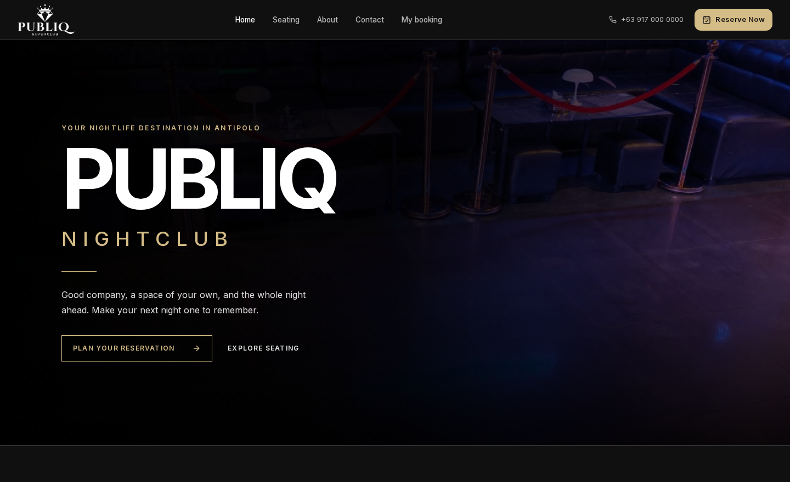

<div align="center">
  
  <h1>PUBLIQ Reservations</h1>
  <p>A mobile-first reservation website and management console for PUBLIQ.</p>
  <p><strong>Next.js</strong> · <strong>TypeScript</strong> · <strong>MongoDB</strong> · <strong>Tailwind CSS</strong></p>
</div>



<p align="center"><sub>Local preview with example contact information. Venue photography is supplied by PUBLIQ.</sub></p>

> [!WARNING]
> **Review and testing only — not production-ready.** The old front-desk booking workflow is disabled rather than integrated. Role permissions need a complete direct-URL/API security review. Do not accept real bookings or sensitive guest data until these and the other [launch blockers](#current-status) are resolved.

## Overview

PUBLIQ combines a guest-facing seating showcase and reservation flow with a private staff console. The interface is designed for phones first, with a dark, subtle-gold visual identity.

- **Seating showcase:** seven VIP booths and five couch spaces, with venue photography and mobile-friendly photo viewing.
- **Guest reservations:** Google sign-in and automatic confirmation for supported VIP bookings when the feature is enabled. The server checks pricing, availability and booking conflicts.
- **Private management:** a sign-in-protected console for viewing and cancelling website seating bookings. The old front-desk workflow is disabled.
- **Club details:** Antipolo City, Rizal, Philippines; the exact street address should be supplied and saved in settings. Booking submissions can be made at any time; arrival choices are within the 9 PM–4 AM club night.

## Current status

This project is in local review. Its public booking feature defaults to **off**. Before any real-world use:

- Use a fresh database with no old reservations. The old front-desk API and screens are disabled; the website seating claims are the only active booking inventory. This does not import old reservations or block seats for phone or walk-in bookings.
- Add and verify website-booking check-in and payment recording. Staff can cancel confirmed website bookings from the reservations page, which releases the relevant seat claims.
- Finish testing Staff, Admin and Super Admin permissions, including direct pages and API requests. Two-factor authentication is not enabled.
- Confirm couch and combined VIP 3+4 capacities before enabling those bookings. The current VIP 5/6 maximum of 10 is an assumption requiring confirmation.
- Configure and test Gmail and the authenticated scheduler with controlled recipients. See [Gmail setup](docs/GMAIL-SETUP.md). The new seating flow queues guest and staff emails, but live delivery has not been verified; it does not send SMS or offer guest-initiated cancellation.
- Review dependency advisories, trusted proxy/rate-limit configuration, secrets, operational backups and actual hosted tests before deployment.

VIP 3 and 4 are represented as separate spaces; combined booking remains gated until capacity is confirmed. For the confirmed VIP pricing tiers and photo assignments, see the [venue specification](docs/PUBLIQ-VENUE-SPEC.md).

## Getting started

**Requirements:** Node.js 22 LTS, npm, and a MongoDB replica set (a local single-node replica set or MongoDB Atlas). Transactions are required for safe booking claims.

1. Clone or extract the repository, then open a terminal in the folder containing `package.json`.
2. Install the locked dependencies:
   ```bash
   npm ci
   ```
3. Create `.env.local` from `.env.example` and configure a **disposable local database** and bootstrap credentials. Never commit `.env.local`.
4. Start MongoDB in replica-set mode, initialize it and create the initial Super Admin using the [step-by-step local setup guide](docs/LOCAL-SETUP.md).
5. Start the app:
   ```bash
   npm run dev
   ```
   Visit `http://localhost:3000` and `/admin/login`.

The legacy demo inventory and seed commands are not the real venue inventory. Do not use them for real bookings. Existing databases contain saved settings; changes to source defaults do not necessarily overwrite those settings. Check the address, map link and 9 PM–4 AM hours in **Admin → Settings**.

For optional Google sign-in and temporary ngrok previews, see [Google & booking setup](docs/GOOGLE-AND-BOOKING-SETUP.md) and [local setup: ngrok](docs/LOCAL-SETUP.md#preview-through-ngrok). A temporary tunnel exposes your local server to the internet; use test data and protect the link.

## Documentation

| Guide | What it covers |
| --- | --- |
| [Documentation index](docs/README.md) | Where to find each guide and historical notes |
| [Local setup](docs/LOCAL-SETUP.md) | Install, local database, admin setup and ngrok preview |
| [Google & booking setup](docs/GOOGLE-AND-BOOKING-SETUP.md) | OAuth configuration and booking setup |
| [Venue specification](docs/PUBLIQ-VENUE-SPEC.md) | Seating, photos, rules and unconfirmed details |
| [Staging deployment](docs/DEPLOYMENT-STAGING.md) | Staging preparation and operational checks; not production approval |
| [Historical documentation](docs/archive/) | Previous README and phase notes, retained for reference |

## Technology

| Layer | Tools |
| --- | --- |
| Application | Next.js 15 App Router, React, TypeScript |
| Interface | Tailwind CSS 4, Radix UI, Lucide |
| Data | MongoDB, Mongoose, replica-set transactions |
| Authentication | Google OAuth for guests; bcrypt and database-backed sessions for admin |
| Testing | TypeScript checks, Playwright and isolated MongoDB integration scripts |

## Verification

```bash
npm run typecheck
npm run build
npm run test:ui:menu
npm run test:ui:seat-photos
npm run test:ui:seating
npm run test:publiq:policy
```

Browser tests require a running app and Playwright browser binaries. Database integration scripts can **write and delete data**: read the script instructions and use only a disposable test database, never a real venue database. Some historical test suites describe the legacy booking system and do not prove production readiness of the newer flow.

## Repository safety

- `.env.local`, credentials, node modules, build output and local test artifacts are excluded by `.gitignore`. Inspect staged changes before publishing and never commit secrets or personal data.
- The example environment file contains placeholders; replace them privately. Do not put real credentials in screenshots, logs, issues or pull requests.
- If a credential was exposed in a URL or log, rotate it, revoke affected sessions and remove exposed material from accessible histories where possible. Removing a file from a commit does not revoke a leaked secret.
- The project includes PUBLIQ branding and venue photos. Confirm you have permission to publish those assets before making the repository public.

## Project structure

```text
src/app/          Public pages, admin routes and API handlers
src/components/   Site, admin and shared UI components
src/lib/          Authentication, database, booking services and utilities
public/images/    Brand assets and venue photography
docs/             Setup guides, venue specification and historical notes
scripts/          Seed, maintenance, packaging and verification scripts
```

Built for PUBLIQ. Deployment and production operation require a separate security and readiness review.
